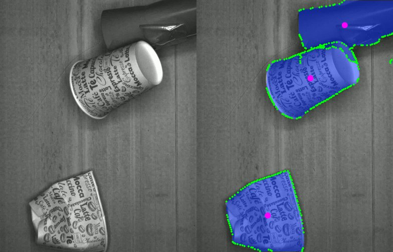
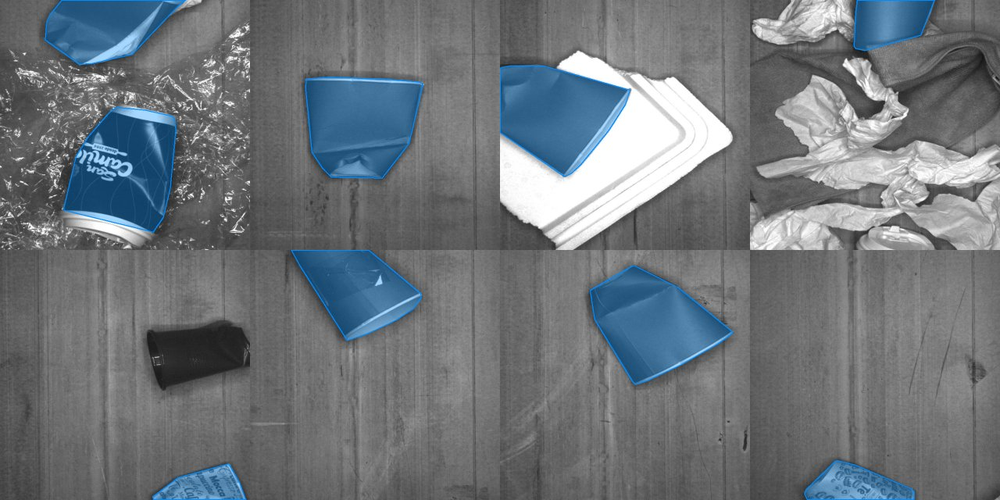
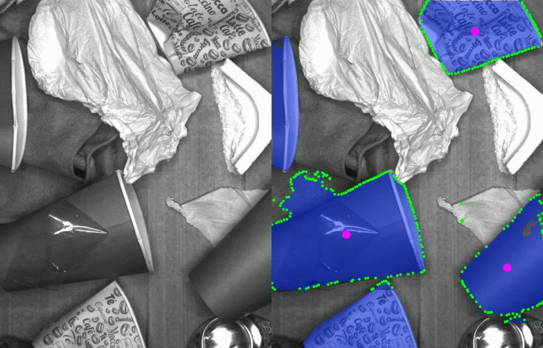

# YOLO Recycle – Paper Cup Segmentation for Robotic Picking

This project detects and segments **paper cups** in images from a conveyor-mounted camera so that an **ABB picker robot** can pick them. It uses an [Ultralytics YOLO](https://docs.ultralytics.com/) instance segmentation model trained on a custom dataset hosted on Roboflow.

The pipeline has three parts:

1. **Data acquisition**: the robot's vision system (ABB PickMaster with a custom package) sends camera images to a Python TCP server, which stores them for the dataset (`socket/record_dataset.py`).
2. **Training**: a YOLO segmentation model is trained on the labeled dataset with one class, `paper_cup` (`train.py`).
3. **Inference for picking**: the trained model runs on a TCP server that gets images from PickMaster and returns the pick position of each cup (`socket/yolo_socket.py`).

For offline testing, `yolo_webcam.py` and `yolo_video.py` run the model on a webcam or on recorded videos.



## Project structure

```
yolo-recycle/
├── models/
│   └── pat-papercup-seg.pt   # Trained segmentation model
├── docs/images/              # Images used in this README
├── videos/                   # Test videos (download them, see "Testing")
├── socket/
│   ├── record_dataset.py     # TCP server: receives images and saves them for the dataset
│   ├── yolo_socket.py        # TCP server: receives images and returns cup positions to the robot
│   └── socket_test.py        # TCP server for testing the connection with PickMaster
├── data.yaml                 # Dataset configuration (paths, classes, Roboflow project)
├── download_dataset.py       # Downloads the dataset from Roboflow
├── train.py                  # Trains the model
├── yolo_webcam.py            # Live inference on a webcam
├── yolo_video.py             # Inference on a video file
├── requirements.txt
└── .env                      # Your Roboflow API key (not committed)
```

## Setup

Requirements: Python 3.13 and, for GPU training and inference, an NVIDIA GPU with a recent driver. The scripts fall back to the CPU if no GPU is available.

```powershell
py -3.13 -m venv venv
.\venv\Scripts\Activate.ps1
pip install -r requirements.txt
```

`requirements.txt` installs PyTorch built for CUDA 12.8. To check that the GPU is detected:

```powershell
python -c "import torch; print(torch.cuda.is_available())"
```

> Do not install the `roboflow` Python package in this environment. It depends on `opencv-python-headless`, which replaces the OpenCV build that `cv2.imshow` needs, so the video windows stop working.

## 1. Download the dataset

The dataset is the Roboflow project `pat-industrial/paper-cup-segment-7v9uf` (version 1, see `data.yaml`). It has 2873 training images, 180 validation images and 60 test images, annotated with segmentation polygons.

The images are grayscale frames from the conveyor camera. They include crushed and intact cups, cups partly out of frame, and other waste such as plastic film, paper, foam trays and plastic cups, which are not labeled. Some images contain no cups at all.



Downloading it requires a Roboflow API key. A free account works.

1. **Get your API key.** Sign in at [app.roboflow.com](https://app.roboflow.com), open your workspace menu (top left), then go to **Settings → API Keys** and copy the **Private API Key**.

2. **Put the key in `.env`.** Create a file named `.env` in the project root, or edit the existing one, with this line. Use no quotes and no spaces:

   ```
   ROBOFLOW_API_KEY=your_private_api_key
   ```

   `.env` is listed in `.gitignore`. Never commit it or share it, because the key gives access to your Roboflow account.

3. **Run the download script:**

   ```powershell
   python download_dataset.py
   ```

   The script reads the workspace, project and version from `data.yaml`, waits while Roboflow prepares the export, and extracts it into `pat-papercup-seg/`.

   Options:

   | Option | Default | Description |
   |---|---|---|
   | `--version N` | value in `data.yaml` | Dataset version to download |
   | `--format F` | `yolov8` | Roboflow export format |
   | `--out DIR` | `pat-papercup-seg/` | Output folder |

   If you get a `401` or `403` error, the key is wrong or your account cannot access the project.

   **Alternative without the script:** in Roboflow, export the dataset in **YOLOv8** format as a zip, and extract it into `pat-papercup-seg/`.

## 2. Train

```powershell
python train.py
```

`train.py` fine-tunes the existing model `models/pat-papercup-seg.pt` on the dataset described in `data.yaml`, with these settings:

| Parameter | Value | Notes |
|---|---|---|
| `epochs` | 200 | |
| `imgsz` | 640 | |
| `batch` | 16 | Uses about 2 GB of VRAM |
| `freeze` | 10 | The first 10 layers (backbone) are frozen |
| `workers` | 2 | Data loading processes |
| `device` | `cuda` | |

Results are saved in `runs/segment/pat-papercup-seg_v2/`:

- `weights/best.pt`: the model with the best validation score. Copy it to `models/` to use it in the other scripts.
- `weights/last.pt`: the latest checkpoint. Resume an interrupted run with `YOLO("runs/segment/pat-papercup-seg_v2/weights/last.pt").train(resume=True)`.
- `results.csv`, `results.png`, confusion matrices and example predictions.

> **Windows:** if training crashes with `OSError: [WinError 1455] The paging file is too small`, lower `workers` in `train.py` (to 1 or 0), or increase the Windows paging file size. Each data loading worker loads its own copy of the PyTorch CUDA libraries.

## 3. Test

### Test videos

Download the videos and put them in the `videos/` folder:

| File | Link |
|---|---|
| `papercup_1min.mp4` | [Google Drive](https://drive.google.com/file/d/1x5iicaoDDBY7_AcoQr5O5dF7p4a_yIW-/view?usp=sharing) |
| `papercup_light.mp4` | [Google Drive](https://drive.google.com/file/d/1eRxakaZd9MxUyjy08lUIEb5cR7U3Yz9d/view?usp=sharing) |

### Inference on a video

```powershell
python yolo_video.py                      # uses videos/papercup_light.mp4
python yolo_video.py papercup_1min.mp4    # a file name is looked up in videos/
python yolo_video.py path\to\video.mp4 --conf 0.5
python yolo_video.py papercup_1min.mp4 --step
```

For each cup whose mask is larger than 20000 pixels (at model resolution), the script draws:

- a **magenta dot** at the mask centroid, which is the pick point,
- **green dots** along the mask contour.

Cups with smaller masks, such as those cut off at the image border, are still segmented but get no pick point:



| Option | Default | Description |
|---|---|---|
| `video` | `papercup_light.mp4` | Path, or a file name inside `videos/` |
| `--conf` | `0.25` | Minimum detection confidence |
| `--step` | off | Advance one frame per key press |

Press `q` to quit.

### Inference on a webcam

```powershell
python yolo_webcam.py
python yolo_webcam.py --camera 1 --conf 0.5
```

This shows the camera image with the predicted masks and boxes. The default confidence is `0.75` and the default camera index is `0`. Press `q` to quit.

## 4. Robot integration (socket scripts)

The scripts in `socket/` connect the model to the ABB picker robot. The robot's vision is handled by **ABB PickMaster**, extended with a **custom package** (not included in this repository). That package captures camera images, sends them over TCP to a Python server, and turns the server's reply into pick targets for the robot.

```
┌────────────┐   image    ┌──────────────────────────┐   image (TCP)    ┌───────────────────────┐
│   Camera   │ ─────────▶ │  PickMaster + custom pkg │ ───────────────▶ │  Python server        │
└────────────┘            │  (TCP client)            │ ◀─────────────── │  (YOLO on GPU)        │
                          └────────────┬─────────────┘   positions      └───────────────────────┘
                                       │ pick targets
                                       ▼
                               ┌───────────────┐
                               │  ABB picker   │
                               └───────────────┘
```

### Communication protocol

All servers listen on `192.168.88.11:5000`, hard-coded in each script. Change `host` and `port` to match your network. PickMaster acts as the **client** and keeps the connection open, sending one image per request:

| Direction | Content |
|---|---|
| PickMaster → server | 4 bytes: image size `N` as a **little-endian** unsigned integer |
| PickMaster → server | `N` bytes: the encoded image (any format Pillow can open, e.g. BMP or JPEG) |
| server → PickMaster | UTF-8 text reply (see each script) |

The server handles each client connection in its own thread. `recv_all()` keeps reading until all `N` image bytes have arrived.

### `socket/yolo_socket.py`: inference server for picking

This is the server used in production. For each received image it:

1. Runs the segmentation model (`pat-papercup-seg.pt`) on the GPU with confidence threshold `0.9`.
2. Keeps only the masks larger than **20000 pixels**, which drops partial or distant detections.
3. Resizes each mask to the camera resolution, **784 × 1006**, and computes its centroid as the pick point.
4. Replies with one entry per cup, where each entry is 4 comma-separated values ending with `;`:

   ```
   <c1>,<c2>,<angle>,<score>;<c1>,<c2>,<angle>,<score>;...
   ```

   - `c1`: mean **row** index of the mask (vertical pixel coordinate).
   - `c2`: mean **column** index of the mask (horizontal pixel coordinate).
   - `angle`: always `0`. Cups are round, so no orientation is needed.
   - `score`: always `1`.

   If no cup is detected, the reply is a single `;`.

The PickMaster custom package parses this string and converts the pixel coordinates to robot coordinates with the camera calibration.

Notes:
- The model is loaded from `pat-papercup-seg.pt` relative to the working directory. Run the script from a folder that contains the model, or change the path to `models/pat-papercup-seg.pt`.
- `results[0].show()` opens a window with the detections for each image that contains cups. This is useful for debugging but can be removed in production.
- The 784 × 1006 resolution is fixed and must match the camera configured in PickMaster.
- If an image has no detections at all, `results[0].masks` is `None` and `len()` raises an error, which closes that client connection. PickMaster then has to reconnect.

### `socket/record_dataset.py`: dataset acquisition server

This server uses the same protocol to **collect training images** from the real camera while the robot is running. It was used to build the dataset that was later annotated in Roboflow. For each received image it:

1. Converts the image to RGB and runs an earlier **detection** model (`best.pt`) with confidence `0.9`.
2. If there is at least one detection:
   - saves the image to `record/labeled/images/<n>.jpg`,
   - saves a pre-label to `record/labeled/labels/<n>.txt` in YOLO detection format, with one line per box: `0 <x_center> <y_center> <width> <height>`, normalized to 0–1.
3. If there are no detections, saves the image to `record/background/images/<n>.jpg`. Background images help reduce false positives.
4. Writes the next image number to `record/last.txt`, so a new session continues numbering where the last one stopped.
5. Always replies `;` (no pick targets), so the robot does not act while recording.

Before running it, create the folder structure and the counter file:

```powershell
mkdir record\labeled\images, record\labeled\labels, record\background\images
Set-Content record\last.txt 0
```

Notes:
- The pre-labels are **bounding boxes**. For the segmentation dataset, the images were uploaded to Roboflow and annotated with polygons there.
- The label writer drops the last two characters of the text (`text[:-2]`), which cuts off the last digit of the final line. Check the pre-labels before using them.

### `socket/socket_test.py`: connection test server

This is a minimal server for checking the network link with PickMaster's `ConnectToSocket` without loading any model. It accepts connections on the same host and port, and prints each message it receives as UTF-8 text. It includes a commented-out block that replies to an `ANALYZE` message with a random hit in the `x y angle score` format. Uncomment it to test how PickMaster handles results without a camera or a GPU.
